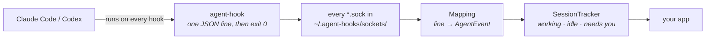
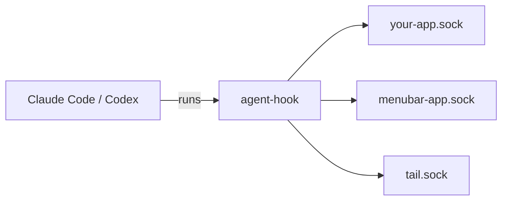

# How agent-hooks works

Updated 2026-10-24. [README.md](README.md) is the short version. This is
the tour: how the hooks get installed, what happens each time one fires,
and how that becomes a list of sessions. The code and its tests have
every rule.



The sections follow that path, left to right.

## 1. Installing the hooks

`agent-hooks install` adds one entry for each hook it uses:

| File | What it adds |
| --- | --- |
| `~/.claude/settings.json` | An entry for each of Claude Code's 14 hooks |
| `~/.codex/hooks.json` | An entry for each of Codex's 9 hooks |
| `~/.codex/config.toml` | `hooks = true` under `[features]`, which Codex needs to run hooks at all. It was once `codex_hooks`, which Codex still reads but warns about at every start, so installing renames an old one, and `status` calls an install with it out of date |

Every entry runs the `agent-hook` sitting next to `agent-hooks`. So copy
both somewhere stable first, as the README does: if they stay in the
build folder, cleaning it breaks every hook. `--hook PATH` points the
entries at a client somewhere else.

**It leaves everything else alone.** It recognises its own entries by
the program they run, and never touches anyone else's hooks. A settings
file that's a symlink (a dotfiles setup) is written through, not
replaced, and nothing is written when nothing would change. Installing
twice is the same as installing once.

It does reformat the two JSON files: when it changes one, it writes the
whole file back pretty-printed, with its keys sorted. What's in them
stays the same, but the layout and key order may not.

**It knows when it's out of date.** `agent-hooks status` checks each
agent and reports one of:

| Health | Meaning |
| --- | --- |
| `installed` | The entries are exactly what a fresh install would write |
| `installed, keeping text` | The same, installed with `--keep-text` |
| `outdated: run agent-hooks install` | Some are missing or old, say after an update added a hook |
| `not installed` | None of its entries are there |
| `installed, but hooks are turned off in FILE` | Its entries are there, but you turned the agent's hooks off |
| `no agent-hook at the path given` | There's no `agent-hook` where the entries point |
| `unreadable: WHY` | The settings file is there but isn't valid, so it's left alone |
| `not found` | The agent's folder (`~/.claude` or `~/.codex`) isn't there |

An app can use the library's `HookInstaller` to **repair** outdated
entries every time it launches. Repair never installs for an agent that
had none, and never turns hooks back on that you turned off.

`agent-hooks remove` takes out exactly its own entries, and leaves two
things behind. `hooks = true` stays in `config.toml`, since other
hooks may rely on it. And a JSON file that held only its entries is
left as an empty `{}` rather than deleted. After any of these, restart
open agent sessions: they read their hooks at startup.

**The entries are every app's.** One client serves every app listening
(§3), so an app that uninstalls itself takes its own listing out of
the sockets folder first, and removes the entries only when
`HookSocket.listed` names no other app: an app listed by its link,
which stays while it's closed, or a socket something listens at now.
Removing them under another app would deafen it, and its repair would
never add them back, since repair doesn't install for an agent with
none. `HookInstaller.uninstall(as:socket:)` does all of it: the app's
listing (`HookSocket.unregister`, only the link to its own socket),
then, with no other app listed, each agent's entries and the
`agent-hook` they ran, and it says what it took out and what it left.
A listing doesn't say whose app it is, so an app with copies of its own
listed beside it, each hearing its entries, names them (`copies`) and
they don't keep the entries.

## 2. The hook client

Each time a hook fires, the agent runs `agent-hook claude` (or `codex`)
and pipes it the hook's JSON. The client then:

1. **Reads** up to 256 KB, and ignores the rest.
2. **Keeps** a few plain facts: which hook, which session, the folder,
   the tool. Each is cut to 200 characters. Without a hook name and a
   session, it sends nothing.
3. **Adds** the thread's name, as the agent's app shows it, which app
   the agent runs in, where in its terminal, and the agent's process
   (below).
4. **Sends** the result as one JSON line to every app listening, and
   exits.

It never prints anything, so it can never answer for the agent. It
always exits cleanly, and within a second whatever happens. Each app
gets 50 ms to take the line, so a stuck listener can't hold it up.

### Your words stay put

By default the client sends plain facts: the hook's name, the session's
ID, the folder the agent works in, the tool's name, the permission mode,
the bundle ID of the app the agent runs in, its terminal tab, and the
agent's process ID and start time. Some
hooks add a few more, all listed under *Its fields* below: the tool
call's ID, which subagent, a command's topic, an edit's size, the
to-do list's counts, an error's class. The one thing you or the
agent wrote that leaves by default is the thread's title, as its app
shows it, and that can sum up your prompt.

Install with `--keep-text` and two more things come along: your
prompt and the agent's last message, up to 2,000 characters each.
Commands, tool output, a to-do's words, error text, file contents and
transcripts never leave.

Lines go only to Unix sockets in `~/.agent-hooks/sockets/`, a folder
only you can write to, and never over the network.

Commands still get a **topic**, worked out in memory and then
forgotten: `tests`, `build`, `deploy`, `docs`, or `inspect` for one that
only reads. To teach it your own command shapes, add them to
`~/.agent-hooks/topics.json`:

```json
{
  "tests": [["just", "check"]],
  "build": [["./build.sh"]]
}
```

Edits get a **size** the same way (`EditSize`): lines added and lines
removed, counted in memory, on `PreToolUse` (what the call will change)
and `PostToolUse` (what it changed). Claude's `Edit`, `MultiEdit` and
`Write` are counted from the result's `structuredPatch` when it has one,
else from the input: an edit's old and new text less the lines they
share at either end, a `Write`'s content all added. Codex's
`apply_patch` is counted from its patch's `+` and `-` lines. Only the
two numbers leave.

The agent's **to-do list** leaves as counts. Claude Code keeps it one
task at a time: each `TaskCreate` and `TaskUpdate` gives the task's ID
and its new status (`pending`, `in_progress`, `completed` or
`deleted`), read from the call's `PostToolUse`, so a call you deny
changes nothing. Claude's older `TodoWrite` and Codex's `update_plan`
send the whole list each time, read from the `PreToolUse`: how many
items are completed, of how many. Nothing of an item but its status
leaves, even with `--keep-text`.

### The agent's process

So an app can tell an agent waiting on you, or working, from one
that's gone (its terminal closed, it crashed, its app quit) without a
`SessionEnd`, the client finds the agent's process (`AgentProcess`): it
walks up from its parent, at most 8 up, to Claude Code's `CLAUDE_PID`
when that's one of them, else to the first that isn't a shell (`sh`,
`bash`, `zsh`, `dash`, `fish`, `ksh`, `tcsh`, `csh`) or a wrapper that
runs a command for someone (`env`, `nice`, `nohup`, `timeout`,
`caffeinate`, `script`, `sudo`). Claude Code itself is `node`, `claude`,
or from its own installer its version (`2.1.304`), never one of those.
It sends the pid and the process's start time (`sysctl`'s
`p_starttime`), since a pid is reused once its process ends.
`agent-hooks tail --sessions` shows each session's `pid` and, while it
runs, its program (`process`), so a process taken for the agent that
isn't one shows.

### Remote Control

A Claude Code session the Claude app drives by Remote Control runs in a
terminal (`claude rc`), and its hooks have the terminal's bundle ID. But
`CLAUDE_CODE_ENVIRONMENT_KIND` is `bridge`, so the client names the
Claude app instead, and its `app_session` is the remote session's ID,
`session_…`, which the app's links open. That ID is in Claude Code's
record of the agent's process, `sessions/<pid>.json` in its config folder
(`$CLAUDE_CONFIG_DIR`, else `~/.claude`): the client reads only that
file, only its first 64 KB, and keeps only its `bridgeSessionId`, when
it has its shape. It reads it only on the hooks that start a session or
a turn (`SessionStart`, `UserPromptSubmit`), so a tool call reads no
file; the tracker keeps the last one it was sent. Without it, the session still opens in the Claude
app, which is brought forward.

### Which terminal tab

So an app can open the agent's own tab, not just its terminal, the
client reads a few more variables, and keeps each only when it has the
shape it should (`TerminalTab`):

| Variable | Kept as | Which terminal |
| --- | --- | --- |
| `TERM_PROGRAM` | `program` | Any: `iTerm.app`, `Apple_Terminal`, `ghostty`, `tmux`… |
| `ITERM_SESSION_ID` | `iterm_session`, the part after the colon: the session's `unique id` | iTerm2 |
| `TERM_SESSION_ID` | `term_session` | Terminal.app (iTerm2 sets it too) |
| `TMUX_PANE`, `TMUX` | `tmux_pane` (`%3`), `tmux_socket` (the server's socket) | tmux, in any terminal |
| none | `tty` (`/dev/ttys003`) | Any; Terminal.app's tabs are found by it |

The tty isn't in the environment. A hook's stdin, stdout and stderr are
pipes, and the hook has no controlling terminal of its own, but the
agent that runs it does: so the client walks up its parent processes to
the first with one (`sysctl`'s `e_tdev`), at most 8 up.

## 3. Any number of apps can listen



There's no background service. An app listens on a Unix socket of its
own and links it into `~/.agent-hooks/sockets/` once. The client sends
every line to every socket in that folder, so every app hears every
hook, and none of them needs to know about the others.

The folder is yours alone (0700). If anyone else can write to it, the
client sends nothing.

For tests, `$AGENT_HOOKS_DIR` moves the folder, and `$AGENT_HOOKS_SOCKET`
sends to one socket only.

## 4. Every hook becomes an event

Claude and Codex name their hooks differently and send different
fields. `Mapping` turns each into one **event** with a **kind** (what
it's about) and a **phase** (where that thing is):

| Hook | Claude Code | Codex | Becomes |
| --- | :---: | :---: | --- |
| `SessionStart` | ✓ | ✓ | `session` start |
| `PostCompact` | | ✓ | `session` start, its `source` `compact`, as Claude's `SessionStart` says after compacting |
| `UserPromptSubmit` | ✓ | ✓ | `turn` start |
| `PreToolUse` | ✓ | ✓ | `tool` start |
| `PermissionRequest` | ✓ | ✓ | `tool` wait, asking for `permission` |
| `Elicitation` | ✓ | | `tool` wait, asking for `input` |
| `Notification`, asking | ✓ | | `tool` wait (it repeats one of the two above) |
| `PostToolUse` | ✓ | ✓ | `tool` end |
| `PostToolUseFailure` | ✓ | | `tool` end, `failed` |
| `ElicitationResult` | ✓ | | `tool` end |
| `Stop` | ✓ | ✓ | `turn` end, `done` |
| `StopFailure` | ✓ | | `turn` end, `failed` |
| `Interrupt` (Esc) | | ✓ | `turn` end, `stopped` |
| An interrupted tool call (Esc) | ✓ | | `turn` end, `stopped` |
| `Notification`, idle at the prompt | ✓ | | `turn` end, `stopped` |
| `SubagentStart`, `SubagentStop` | ✓ | | `subagent` start, end |
| `SessionEnd` | ✓ | ✓ | `session` end |

### Its fields

An event carries only the facts its hook has. These are the names
`agent-hooks tail` prints, and the keys of `AgentEvent`'s `Codable`
form, so an app that keeps events as JSON reads them back with a plain
`JSONDecoder`:

| Field | Example | What it says |
| --- | --- | --- |
| `agent` | `claude` | Which agent: `claude` or `codex` |
| `session` | `s1` | Which session it came from |
| `kind` | `tool` | What it's about, from the table above |
| `phase` | `wait` | Where it is, from the table above |
| `hook` | `PermissionRequest` | The agent's own name for the hook |
| `at` | `1790755425280` | When, in milliseconds |
| `cwd` | `/Users/you/src/landing` | The folder the agent works in |
| `name` | `Fix the nav` | The thread's name, as the agent's app shows it |
| `app` | `com.mitchellh.ghostty` | The app the agent runs in, by bundle ID |
| `app_session` | `local_f0ed…` | The Claude app's own ID for the session: `local_…`, or by Remote Control the remote session's `session_…`, only on a session's or turn's start |
| `terminal` | `{"program": "iTerm.app", "iterm_session": "6A3E…", "tty": "/dev/ttys003"}` | Where in a terminal the agent runs (*Which terminal tab*, above) |
| `mode` | `default` | Claude's permission mode: `default`, `plan`, `acceptEdits`… |
| `process` | `{"pid": 17881, "started": 1791706851309}` | The agent's process, and when it started, in milliseconds (*The agent's process*, above) |
| `subagent` | `a1b2…` | The Claude subagent it came from; none for the main agent |
| `subagent_type` | `Explore` | What kind of subagent |
| `source` | `startup` | On a `session` start: `startup`, `resume`, `clear` or `compact` |
| `prompt` | `fix the nav` | On a `turn` start: your prompt, only with `--keep-text`; never a notice the agent's harness typed for you, such as Claude Code's `<task-notification>` that a background command finished |
| `tool` | `Bash` | On a `tool` event: the tool |
| `tool_use_id` | `toolu_1` | On a `tool` start or end: which call |
| `topic` | `tests` | What a command is about, without the command |
| `lines_added`, `lines_removed` | `12`, `3` | On an edit's `tool` start or end: its size in lines, never its text |
| `todo_id`, `todo_status` | `1`, `completed` | On a `tool` end: a task the agent created or updated, and its new status |
| `todos_done`, `todos_total` | `1`, `3` | On a `tool` start: the agent's whole to-do list, as counts |
| `asking` | `permission` | On a `tool` wait: `permission`, or `input` for a question |
| `notice` | `permission_prompt` | When the event came from Claude's `Notification`, its type |
| `failed` | `false` | On a Claude `tool` end: whether the call failed |
| `error` | `rate_limit` | On a failure: the error as a short class, which the client works out, never its text: a turn's from `TurnError`, a call's from `ToolError` |
| `outcome` | `done` | On a `turn` end: `done`, `failed`, or `stopped` |
| `message` | `Fixed it.` | On a `turn` end: the agent's last message, only with `--keep-text` |

In Swift these are `AgentEvent`'s properties, in camel case. It adds
**`toolKind`**, worked out from `tool`, so you needn't learn every
agent's tool names: `shell`, `edit`, `read`, `search`, `web`,
`subagent`, `planning` (which includes the to-do tools), `mcp` or
`other`.

## 5. Events become sessions

`SessionTracker` follows the events and keeps one entry per session.
Each is **working**, **idle** or **needs you**, with its project and
workspace (from the folder's git repository, branch or worktree), its
running tool calls and its subagents, and its `turn`: when the turn
open started, and its number, counting your prompts since the tracker
first saw the session. An app that keeps more about each turn (what its
calls did, say) reads these and the tracker's `Change` for each event,
rather than keeping sessions of its own: then the two can't disagree.
`turn.callStart(for:)` finds a result's call before the tracker handles
it, for a result whose hook line lost its topic.

Each session also keeps the agent's process (`process`), and its to-do
list (`todos`: `done` and `total`). A whole list replaces it; a task is
kept by its ID until it's deleted, and one created once every task is
completed starts a new list. The list lasts from turn to turn, as the agent's
does, until a prompt finds it all done, and goes when the session ends. A subagent's whole list is its
own, and doesn't count.

Here's Claude asking to run the tests in a worktree, as
`agent-hooks tail --sessions` printed it, one line each. The tool call
starts, and the session is working; then Claude asks permission, and the
session needs you:

```json
{"agent":"claude","app":"com.mitchellh.ghostty","at":1791707045939,"cwd":"/Users/you/src/landing/.worktrees/fix-nav","hook":"PreToolUse","kind":"tool","mode":"default","phase":"start","process":{"pid":17881,"started":1791706851309},"session":"s1","terminal":{"program":"ghostty","tty":"/dev/ttys003"},"tool":"Bash","tool_use_id":"toolu_1","topic":"tests"}
{"at":1791707045939,"pid":17881,"process":"2.1.304","project":"landing","session":"claude/s1","state":"working","workspace":"fix-nav"}
{"agent":"claude","app":"com.mitchellh.ghostty","asking":"permission","at":1791707046252,"cwd":"/Users/you/src/landing/.worktrees/fix-nav","hook":"PermissionRequest","kind":"tool","mode":"default","phase":"wait","process":{"pid":17881,"started":1791706851309},"session":"s1","terminal":{"program":"ghostty","tty":"/dev/ttys003"},"tool":"Bash"}
{"asking":"permission","at":1791707046252,"pid":17881,"process":"2.1.304","project":"landing","session":"claude/s1","state":"needs_you","workspace":"fix-nav"}
```

### Why "needs you" is the hard part

It has to be right every time, and the hooks don't make that easy:

- **The same request can arrive twice.** Claude's `Notification`
  repeats a request its own hook already made.
- **Subagents ask alongside their parent**, so one session can have
  several requests open.
- **Codex asks early.** Its hook fires before its automatic reviewer
  decides whether to ask you at all, so its requests wait 2 s before
  they count.
- **Hooks arrive late.** Some land after their session has ended, and
  mustn't bring it back.
- **Nothing reports an answer.** No hook says you approved or pressed
  Esc, so the next event has to say.
- **Nothing reports an agent gone.** Close its terminal and no
  `SessionEnd` comes. So every 5 s, the tracker checks each session
  silent that long that waits on you or works: if its agent's process
  has ended, its request clears and its turn stops, and the session
  stays, idle. The tracker says so (`agentGone`), so an app can tell
  that from an answer, and `agent-hooks tail --sessions` marks the
  session's `idle` line `"agent_gone":true`. While the process runs, a
  request waits however long it's silent, up to a day. A Mac that
  slept needs nothing special: the next check sees.
- **A turn's end can be lost.** The client gives each app 50 ms and
  never retries, and an interrupt may send no hook at all. So a turn
  silent an hour isn't working, whatever its process: a turn sends a
  hook at every tool call, and no call runs that long in silence
  (Claude's commands time out at 10 minutes). Only waiting lasts as
  long as the agent does.

An idle session's process isn't checked: one process can outlive many
sessions (the Codex app's one server, a new thread in a running CLI),
and one may end with each turn. Any session is forgotten after a
silent day, one waiting on you included, so the table is what the last
day of events rebuilds, as an app that reads a day back at launch
does. A session with no process to check (from an older hook client)
stops needing you after 10 silent minutes, whatever happened; the
tracker says so (the request expired), and `agent-hooks tail
--sessions` marks that line `"expired":true`.

## The command line

| Command | What it does |
| --- | --- |
| `agent-hooks install [claude\|codex] [--keep-text] [--hook PATH]` | Adds the hooks for the agent named, or every one found |
| `agent-hooks remove [claude\|codex]` | Takes its entries out, leaving `hooks = true` on |
| `agent-hooks status [--hook PATH]` | Each agent's health, and the apps listening |
| `agent-hooks tail [--sessions] [--name NAME]` | Prints every event, and with `--sessions` each session's state as it changes |
| `agent-hooks doctor [--hook PATH]` | `status`, then a made-up hook through the client, to check it works |

`--home DIR` points `install`, `remove`, `status` and `doctor` at
another home folder (the default is `$HOME`). `--hook PATH` is the
`agent-hook` that `install` writes into the entries, and that `status`
and `doctor` check (the default is the one next to `agent-hooks`).
`--help` after any command prints them all.

Two examples to steal:

- [Examples/watch.sh](Examples/watch.sh): your agents at a glance, in
  colour (the README's GIF).
- [Examples/needs-you-notify.sh](Examples/needs-you-notify.sh): a macOS
  notification each time an agent needs you.

## The library

Add it to your `Package.swift`:

```swift
.package(url: "https://github.com/Mellow-Machines-Lab/AgentHooks.git", from: "1.0.1"),
// and in a target's dependencies:
.product(name: "AgentHooks", package: "AgentHooks"),
```

Three pieces do the work:

- `HookServer` listens on a socket.
- `Mapping.event(from:)` turns each line into an `AgentEvent`.
- `SessionTracker` keeps the sessions. Touch it from one queue, and call
  `advance(to:)` about once a second so its timers run. It returns what
  the timers did that the table can't show: each session that stopped
  because its agent is gone (`agentGone`), and each request that expired
  (`requestExpired`).
  `handle` runs the timers due by its event's time
  too, so to hear those, call `advance(to: event.at, sparing: event.key)`
  first.

This prints each time an agent starts waiting on you, and each time one
is gone or a request nobody answered expires:

```swift
import AgentHooks
import Foundation

/// Prints each time an agent session starts waiting on you.
final class Watcher: @unchecked Sendable {
    let queue = DispatchQueue(label: "watcher")  // the tracker's one queue
    let tracker = SessionTracker()
    var waiting: Set<String> = []
    var keep: [Any] = []

    func now() -> Int64 { Int64(Date().timeIntervalSince1970 * 1000) }

    func start(socket: String) throws {
        let server = HookServer(path: socket) { [self] line in
            queue.async { [self] in
                guard let event = Mapping.event(from: line, receivedAt: now()) else { return }
                let timers = tracker.advance(to: event.at, sparing: event.key)
                tracker.handle(event)
                report(timers)
            }
        }
        try server.start()
        try HookSocket.register(socket, as: "needs-you")  // agent-hook now sends here too
        // The timers: Codex's 2 s grace, the check that agents still run.
        let tick = DispatchSource.makeTimerSource(queue: queue)
        tick.schedule(deadline: .now() + 1, repeating: 1)
        tick.setEventHandler { [self] in
            report(tracker.advance(to: now()))
        }
        tick.resume()
        keep = [server, tick]
    }

    func report(_ timers: [String: SessionTracker.Change]) {
        for (key, change) in timers.sorted(by: { $0.key < $1.key }) {
            switch change {
            case .agentGone: print("\(key) stopped: its agent quit")
            case .requestExpired: print("\(key) stopped waiting: nobody answered in 10 minutes")
            default: break
            }
        }
        let asking = tracker.grouped(at: now()).waiting
        for s in asking where !waiting.contains(s.key) {
            let what = s.asking == .input ? "has a question" : "wants permission"
            print("\(s.agent.displayName) in \(s.name ?? s.project) \(what)")
        }
        waiting = Set(asking.map(\.key))
    }
}

let watcher = Watcher()
try watcher.start(socket: NSTemporaryDirectory() + "needs-you.sock")
dispatchMain()
```

The library has a few more pieces for apps:

- `HookInstaller` installs, checks and repairs the hooks, from your
  own app, and takes your app out again (`uninstall(as:socket:)`, §1).
- `Place` and `Places` name a folder's project and workspace.
- `ThreadLink` opens a session's thread where it runs: in the Claude or
  Codex app by a link (a Remote Control session's by its remote
  session, `claude://code/session_…`); in iTerm2 (by the session's `unique id`, else its
  tty) or Terminal.app (by the tab's tty) with an AppleScript run by
  `osascript`; in tmux by selecting its pane (`tmux select-window`,
  `select-pane`) and bringing the terminal forward; otherwise by
  bringing the agent's app forward, as it also does when a script finds
  no tab. Each id is checked against its shape again before it goes into
  a script or a command. The first time your app scripts iTerm2 or
  Terminal.app, macOS asks you to allow it (System Settings, Privacy &
  Security, Automation), and an app needs `NSAppleEventsUsageDescription`
  in its `Info.plist` for macOS to ask at all.

## Good to know

- **Some of it reads undocumented internals**: the thread's name
  (Claude's transcript, Codex's `session_index.jsonl`), which app the
  agent runs in, its terminal tab, a Remote Control session's ID
  (Claude Code's `sessions/<pid>.json`), the shape of Claude's edit
  results, its task tools and Codex's `PostToolUse` and `update_plan`
  input (none yet recorded), and what Claude's idle notification means. An agent
  update can break these. If one does, the name goes missing or the
  thread doesn't open, but the events still come.
- **Hooks can't see everything.** No hook says you approved, so a long
  command you approved keeps "needs you" up until it finishes. Codex's
  automatic reviewer sends no hook either, so a command it approves that
  runs past the 2 s grace shows "needs you" when nobody was asked.
- **Apps share one set of entries.** Apps that install hooks must agree
  on the client's path and on `--keep-text`, or each one's repair undoes
  the other's, and an app that uninstalls itself leaves them while
  another is listed (§1).
- **Tested against** Claude Code 2.1.263 and Codex CLI 0.153.4
  ([the fixtures](Tests/AgentHooksTests/Fixtures/VERSIONS.md)). macOS
  only.

## Development

```sh
swift test --scratch-path .build/tests
```

The tests use Swift Testing, and the recorded hooks are in
`Tests/AgentHooksTests/Fixtures/`. The package depends on nothing but
Foundation, and on nothing outside this folder. The README's GIF is a
real run of `Examples/watch.sh`. [CONTRIBUTING.md](CONTRIBUTING.md) says
how to send a change.
